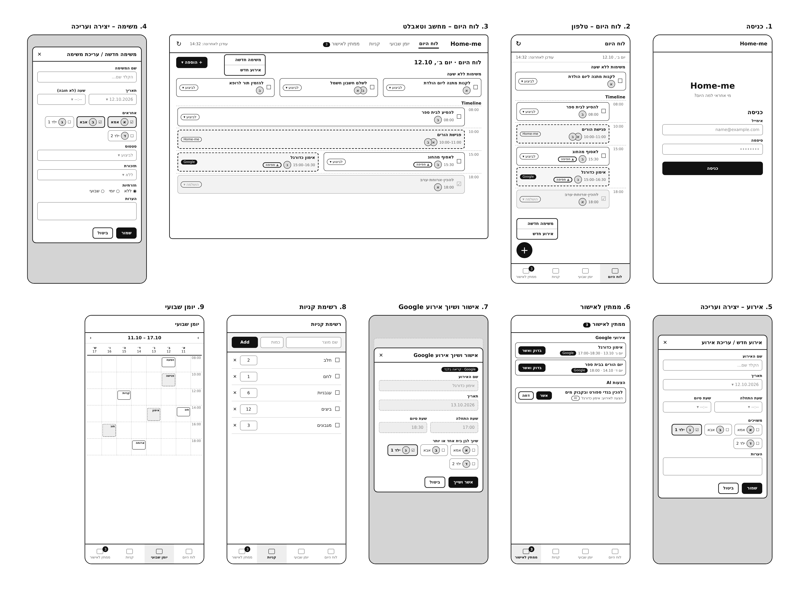
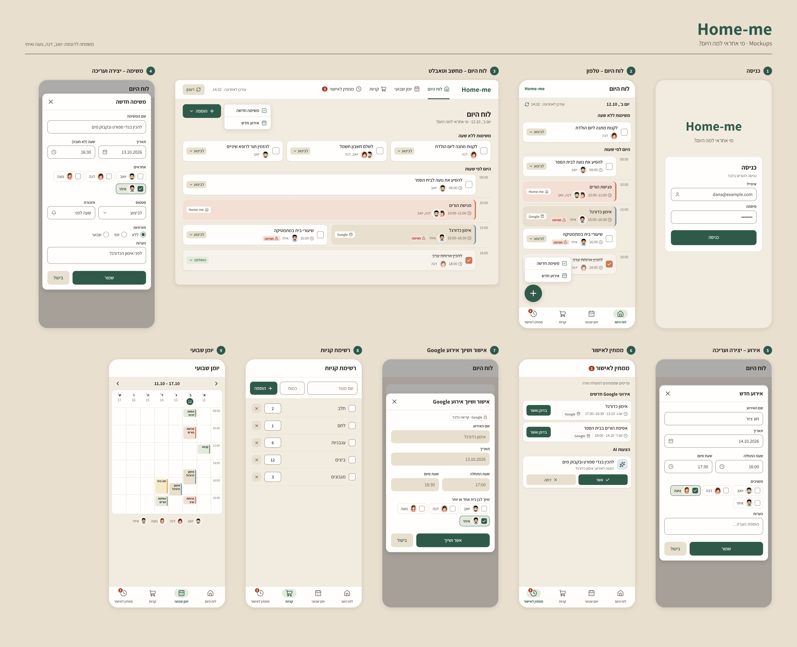
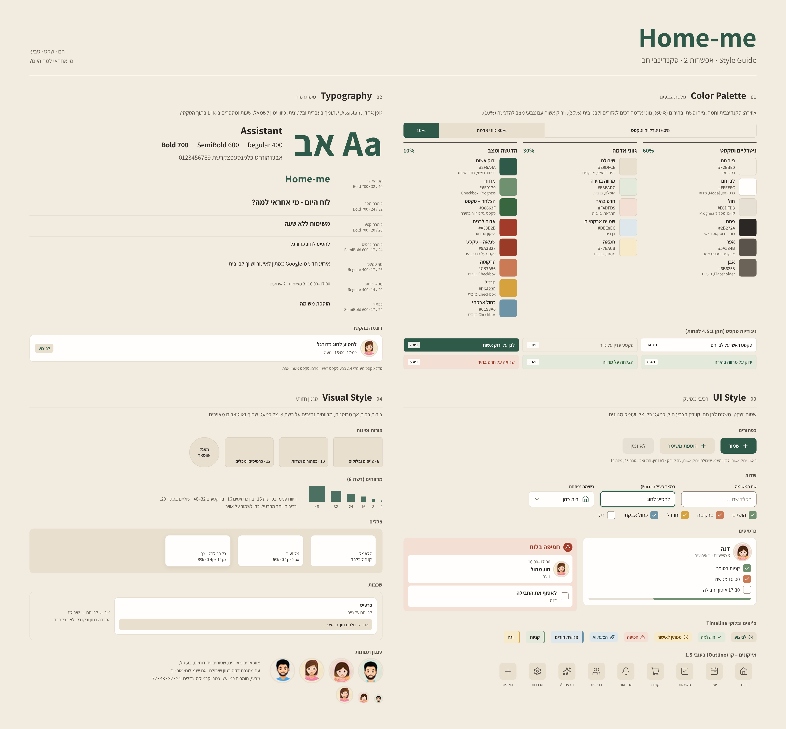

# DESIGN – Home-me V1

מקורות: product-10-definitions.md, PRD.md, והתמונות wireframes.png, mockups.png ו-style-guide.png.
שמות המסכים זהים לשמות ב-PRD.

---

## חלק 1 – Screens

### כניסה
**המטרה:** כניסה של הורה למערכת (F01). המסך לא נמנה בארבעת המסכים המרכזיים של ה-PRD, אבל הוא נדרש לטופס הכניסה.

**מה יש במסך:**
- שם המוצר Home-me והשאלה "מי אחראי למה היום?".
- כרטיס כניסה: כותרת "כניסה", שורת הסבר "כניסה להורים בלבד", שדה אימייל, שדה סיסמה.
- כפתור ראשי "כניסה" לרוחב הכרטיס.

**מה קורה בו:** הורה מזין אימייל וסיסמה ולוחץ "כניסה". אחרי כניסה מוצלחת עוברים ל**לוח היום**. אין הרשמה ואין שחזור סיסמה.

---

### לוח היום (Home)
**המטרה:** לענות במבט אחד על "מי אחראי למה היום?".

**מה יש במסך (טלפון):**
- סרגל עליון: "לוח היום" ושם המוצר.
- שורת תאריך ("יום ב׳, 12.10") וליד החיווי "עודכן לאחרונה: 14:32" עם אייקון רענון.
- **מעבר בין ימים (F42, לא מופיע בתמונות):** משני צידי התאריך חצים ‹ › (כפתורי אייקון 44×44, עם `aria-label` "היום הקודם" / "היום הבא"). בכיוון RTL, החץ הימני הוא היום הקודם והשמאלי הוא הבא, כמו בחצי השבוע ביומן השבועי. כשמוצג יום שאינו היום, מופיע ליד התאריך כפתור משני קטן "היום". כותרת הקטע "משימות ללא שעה" ו-"היום לפי שעות" נשארות, והתאריך בשורה מראה איזה יום מוצג.
- **משימות ללא שעה:** כרטיסי משימה בלי שעה.
- **היום לפי שעות (Timeline):** שורות לפי שעה. בכל שורה כרטיסי משימות ואירועים.
- **כרטיס משימה:** Checkbox, שם המשימה, שעה, אווטאר ושם של האחראים, וצ'יפ סטטוס עם חץ ("לביצוע ▾").
- **כרטיס אירוע:** רקע בגוון של בן הבית ופס צבע בצד, שם האירוע, טווח שעות, אווטאר ושם, ותג מקור: "Home-me" או "Google".
- **סימון חפיפה:** צ'יפ אדמדם עם אייקון משולש והמילה "חפיפה", על שני הפריטים החופפים של אותו בן בית.
- **משימה שהושלמה:** Checkbox מסומן, כותרת עם קו חוצה, צבע מוחלש וצ'יפ "הושלמה".
- כפתור + עגול בפינה. לחיצה פותחת תפריט קטן: "משימה חדשה" ו"אירוע חדש".
- סרגל ניווט תחתון: לוח היום, יומן שבועי, קניות, ממתין לאישור (עם מונה).

**מה יש במסך (מחשב וטאבלט):** אותו תוכן בפריסה רחבה.
- סרגל עליון: Home-me, ארבעת הקישורים (הפעיל מסומן בקו תחתון), מונה ב"ממתין לאישור", "עודכן לאחרונה" וכפתור "רענון".
- כותרת "לוח היום" עם התאריך, חצי מעבר בין ימים וכפתור "היום" (כמו בטלפון), וכפתור "הוספה ▾" עם אותו תפריט.
- משימות ללא שעה בשורה אחת של כרטיסים. פריטים חופפים באותה שעה מוצגים זה לצד זה.

**מה קורה בו:**
- לחיצה על צ'יפ הסטטוס משנה סטטוס בין "לביצוע" ל"הושלמה".
- לחיצה על כרטיס משימה פותחת את **יצירה ועריכה של משימה**.
- "משימה חדשה" פותח את **יצירה ועריכה של משימה**, ו"אירוע חדש" פותח את **יצירה ועריכה של אירוע פנימי**.
- רענון טוען מחדש את הנתונים ומעדכן את "עודכן לאחרונה".
- חץ טוען את משימות ואירועי היום הקודם או הבא. "היום" חוזר להיום. "משימה חדשה" ו"אירוע חדש" מוזנים מראש בתאריך היום המוצג.

---

### יצירה ועריכה של משימה (Modal)
**המטרה:** ליצור או לערוך משימה בלי לעזוב את הלוח.

**מה יש במסך:** חלון מעל הלוח המוכהה. כותרת ("משימה חדשה") וכפתור סגירה ✕. שדות:
- שם המשימה.
- תאריך, ושעה (לא חובה).
- אחראים: בחירה מרובה של בני הבית, עם Checkbox, אווטאר ושם.
- סטטוס (רשימה נפתחת).
- תזכורת (רשימה נפתחת).
- חזרתיות: ללא, יומי, שבועי.
- הערות.
- כפתורים: "שמור" (ראשי) ו"ביטול" (משני).

**מה קורה בו:** "שמור" שומר וסוגר, והמשימה מופיעה בלוח. "ביטול" או ✕ סוגרים בלי לשמור.

---

### יצירה ועריכה של אירוע פנימי (Modal)
**המטרה:** ליצור או לערוך אירוע של Home-me.

**מה יש במסך:** חלון באותו מבנה. כותרת ("אירוע חדש") ו-✕. שדות: שם האירוע, תאריך, שעת התחלה, שעת סיום, משויכים (בחירה מרובה), הערות. כפתורים "שמור" ו"ביטול".

**מה קורה בו:** "שמור" שומר וסוגר, והאירוע מופיע בלוח ובתג "Home-me".

---

### ממתין לאישור (Pending)
**המטרה:** מקום אחד לפריטים שממתינים להורה.

**מה יש במסך:**
- כותרת "ממתין לאישור" עם מונה, ושורת הסבר "פריטים שממתינים לפעולת הורה".
- **אירועי Google חדשים:** כרטיס לכל אירוע: שם, יום, תאריך ושעה, תג "Google", כפתור ראשי "בדוק ואשר", וכפתור משני "התעלם" (F43, לא מופיע בתמונות). הסידור כמו בכרטיס הצעת AI: ראשי ואחריו משני.
- **הצעות AI:** כרטיס עם אייקון ניצוצות, שם ההצעה ("להכין בגדי ספורט ובקבוק מים"), שורת "הצעה לאירוע: אימון כדורגל", וכפתורים "אשר" ו"דחה".
- סרגל ניווט תחתון.

**מה קורה בו:**
- "בדוק ואשר" פותח את **אישור ושיוך של אירוע Google**.
- "התעלם" מוציא את האירוע מהתיבה מיד, בלי חלון אישור, והמונה יורד. האירוע לא מופיע בלוח.
- "אשר" הופך את ההצעה למשימה רגילה בלוח. "דחה" מסיר אותה מהתיבה. המונה יורד בהתאם.

---

### אישור ושיוך של אירוע Google (Modal)
**המטרה:** לשייך אירוע מ-Google לבני הבית ולאשר אותו לפני שהוא נכנס ללוח.

**מה יש במסך:** חלון עם כותרת ו-✕. תג "Google · קריאה בלבד" עם אייקון מנעול. שדות נעולים בגוון שיבולת: שם האירוע, תאריך, שעת התחלה, שעת סיום. "שיוך לבן בית אחד או יותר" (בחירה מרובה). כפתורים "אשר ושייך" ו"ביטול".

**מה קורה בו:** "אשר ושייך" מאשר, סוגר וחוזר ל**ממתין לאישור**. האירוע מופיע ב**לוח היום** וב**יומן השבועי**.

---

### רשימת קניות (Shopping List)
**המטרה:** רשימת קניות משותפת ופשוטה.

**מה יש במסך:**
- כותרת "רשימת קניות".
- Quick Add: שדה "שם מוצר", שדה "כמות" וכפתור "הוספה".
- שורה לכל מוצר: Checkbox, שם המוצר, תיבת כמות, וכפתור מחיקה ✕.
- סרגל ניווט תחתון.

**מה קורה בו:** "הוספה" מוסיף מוצר לרשימה. סימון ה-Checkbox מעלים את המוצר מהרשימה. שינוי בתיבת הכמות מעדכן אותה. ✕ מוחק מיד, בלי חלון אישור.

---

### יומן שבועי (Calendar)
**המטרה:** תצוגה של השבוע כולו.

**מה יש במסך:**
- כותרת "יומן שבועי".
- טווח השבוע ("11.10 – 17.10") עם חצים לשבוע הקודם והבא.
- טבלה: עמודה לכל יום (א׳ עד ש׳, עם תאריך, והיום הנוכחי מודגש בעיגול ירוק) ושורות שעות.
- בלוקים של משימות ואירועים בגוון של בן הבית, עם פס צבע ושם הפריט.
- מקרא בני הבית: אווטאר ושם.
- סרגל ניווט תחתון.

**הערה למימוש:** בתמונה, מי אחראי לבלוק מזוהה רק לפי צבע. כדי לעמוד בכלל "מצב לא מועבר בצבע בלבד", צריך להוסיף לבלוק אווטאר קטן או שם.

---

### ניווט בין המסכים
- **כניסה** ← **לוח היום**.
- ארבעת המסכים המרכזיים (לוח היום, יומן שבועי, רשימת קניות, ממתין לאישור) נגישים תמיד: בסרגל התחתון בטלפון, ובסרגל העליון במחשב ובטאבלט.
- **לוח היום** ← כפתור + ← יצירה ועריכה של משימה, או יצירה ועריכה של אירוע פנימי. לחיצה על משימה ← יצירה ועריכה של משימה.
- **ממתין לאישור** ← "בדוק ואשר" ← אישור ושיוך של אירוע Google ← חזרה לממתין לאישור.
- כל Modal נסגר וחוזר למסך שממנו נפתח.

### מה לא מופיע בתמונות
חצי המעבר בין ימים בלוח היום וכפתור "היום" (F42), כפתור "התעלם" בכרטיס אירוע Google (F43), מצבי ריק, טעינה ושגיאה, מצב Focus במסכים, מצב עריכה של החלונות, התג "עודכן ב-Google", התראה על מוצר כפול ויצירת משימה בלחיצה על שעה. הם מתוארים ב-PRD, אבל אין להם עיצוב בתמונות.

---

## חלק 2 – Style Guide

### האווירה
סקנדינבית וחמה: שקטה, טבעית ומשפחתית. רקע נייר בהיר, גווני אדמה רכים, וצבע ירוק אשוח אחד להדגשה. עומק נוצר מגוון ומקו דק, לא מצל כבד.

### צבעים (60-30-10)

**60% – ניטרליים וטקסט**
| שם | HEX | שימוש |
|---|---|---|
| נייר חם | `#F2EBE0` | רקע המסך |
| לבן חם | `#FFFEFC` | כרטיסים, חלונות, שדות, סרגלים |
| חול | `#E6DFD3` | קווים, מפרידים, מסלול Progress |
| פחם | `#2B2724` | כותרות וטקסט ראשי |
| אפר | `#5A534B` | טקסט משני ואייקונים |
| אבן | `#6B6258` | Placeholder והערות |
| רקע מוחלש | `#F7F3EC` | משימה שהושלמה (נוסף, לא בלוח ה-Style Guide) |
| קו מקווקו | `#D8CFC0` | קווי שעות ומסגרת מסך (נוסף, לא בלוח ה-Style Guide) |
| מסגרת שדה | `#8A7F72` | מסגרת שדות ו-Checkbox ריק (נוסף, לא בלוח ה-Style Guide) |

**30% – גווני אדמה**
| שם | HEX | שימוש |
|---|---|---|
| שיבולת | `#E9DFCE` | כפתור משני, צ'יפ סטטוס, שדה נעול, אייקונים |
| מרווה בהירה | `#E3EADC` | "הושלמה", לשונית פעילה, בן בית |
| חרס בהיר | `#F4DFD5` | חפיפה והתראה, בן בית |
| שמיים אבקתיים | `#DEE8EC` | הצעת AI, בן בית |
| חמאה | `#F7EACB` | ממתין, בן בית |

**10% – הדגשה ומצב**
| שם | HEX | שימוש |
|---|---|---|
| ירוק אשוח | `#2F5A4A` | כפתור ראשי, כפתור +, שם המוצר, קישור פעיל |
| מרווה | `#6F9170` | Checkbox מסומן, Progress |
| הצלחה – טקסט | `#38663F` | טקסט על מרווה בהירה |
| אדום לבנים | `#A33B2B` | אייקון התראה, מונה |
| שגיאה – טקסט | `#9A3B28` | טקסט "חפיפה" על חרס בהיר |
| טרקוטה | `#CB7A56` | צבע בן בית |
| חרדל | `#D6A23E` | צבע בן בית |
| כחול אבקתי | `#6C93A6` | צבע בן בית |

**צבע לכל בן בית במסכים:** כל אחד מקבל גוון רקע ופס צבע. יואב: מרווה בהירה ומרווה. דנה: חרס בהיר וטרקוטה. נועה: חמאה וחרדל. איתי: שיבולת וכחול אבקתי.

**שכבת הכהיה מאחורי חלון:** פחם `#2B2724` בשקיפות 38%.

**ניגודיות:** כל זוגות הטקסט על רקע עומדים ב-4.5:1 לפחות.

### גופנים
גופן אחד, **Assistant**, שתומך בעברית ובלטינית. משקלים: Regular 400, SemiBold 600, Bold 700.

| שימוש | גודל / גובה שורה | משקל |
|---|---|---|
| שם המוצר | 32 / 40 | Bold 700 |
| כותרת מסך | 24 / 32 | Bold 700 |
| כותרת קטע | 20 / 28 | Bold 700 |
| כותרת כרטיס | 17 / 24 | SemiBold 600 |
| גוף טקסט | 17 / 26 | Regular 400 |
| מטא וכיתוב | 14 / 20 | Regular 400 |
| כפתור | 17 / 24 | SemiBold 600 |

הכיוון מימין לשמאל. שעות, תאריכים ומספרים מוצגים משמאל לימין בתוך השורה. גודל טקסט מינימלי: 14 לפי ה-Style Guide. במסכים, תגיות קטנות קטנות ממנו מעט.

### כפתורים ורכיבים
- **כפתור ראשי:** רקע ירוק אשוח, טקסט לבן חם. גובה 48, פינה 10.
- **כפתור משני:** רקע שיבולת, טקסט ירוק אשוח, קו דק בצבע חול.
- **כפתור לא זמין:** רקע חול, טקסט אבן.
- **כפתור +:** עיגול ירוק אשוח עם + לבן, וצל רך.
- **שדה:** רקע לבן חם, מסגרת 1 פיקסל, פינה 10, תווית מעל השדה. Focus: מסגרת ירוק אשוח בעובי 2 והילה במרווה בהירה. שדה נעול: רקע שיבולת.
- **רשימה נפתחת:** כמו שדה, עם אייקון וחץ.
- **Checkbox:** ריבוע 22–24 בפינה 5. ריק: מסגרת. מסומן: מילוי בצבע בן הבית או מרווה, עם וי לבן.
- **כרטיס:** לבן חם, קו חול דק, פינה 12, צל זעיר.
- **כרטיס התראה:** רקע חרס בהיר, כותרת אדומה עם אייקון בעיגול, וכרטיסים לבנים בפנים.
- **צ'יפים:** פינה 6, רקע בגוון אדמה וטקסט כהה. לביצוע: שיבולת. הושלמה: מרווה בהירה. ממתין לאישור: חמאה. חפיפה: חרס בהיר. הצעת AI: שמיים אבקתיים.
- **בלוק ב-Timeline וביומן:** רקע בגוון בן הבית ופס צבע של 4 פיקסלים בצד.
- **תגי מקור:** "Home-me" ו-"Google", עם אייקון קטן, על רקע לבן וקו חול.
- **סרגל ניווט תחתון:** לבן חם. לשונית פעילה בירוק אשוח עם רקע מרווה בהירה סביב האייקון. מונה אדום עגול.
- **אייקונים:** קו (Outline) בעובי 1.5, בצבע אפר: בית, יומן, משימות, קניות, התראות, בני בית, הצעת AI, הגדרות, הוספה.
- **אווטארים:** איורים שטוחים וידידותיים, בעיגול על גוון חם, עם מסגרת דקה. גדלים: 24, 32, 48, 72.

### פינות וצורות
- 6: צ'יפים ובלוקים.
- 10: כפתורים ושדות.
- 12: כרטיסים, חלונות ומכלים.
- עיגול: אווטארים וכפתור +.
- במסכים: מסגרת הטלפון בפינה 30.

### מרווחים
רשת 8: 4, 8, 16, 24, 32, 48.
- ריווח פנימי בכרטיס: 16.
- בין כרטיסים: 16.
- בין קטעים: 32–48.
- שוליים במסך: 20.

### צללים
- **ללא צל:** קו חול בלבד.
- **צל זעיר:** `0 1px 2px`, בשקיפות 6%. לכרטיסים.
- **צל רך:** `0 4px 14px`, בשקיפות 8%. לחלון צף ולכפתור +.
