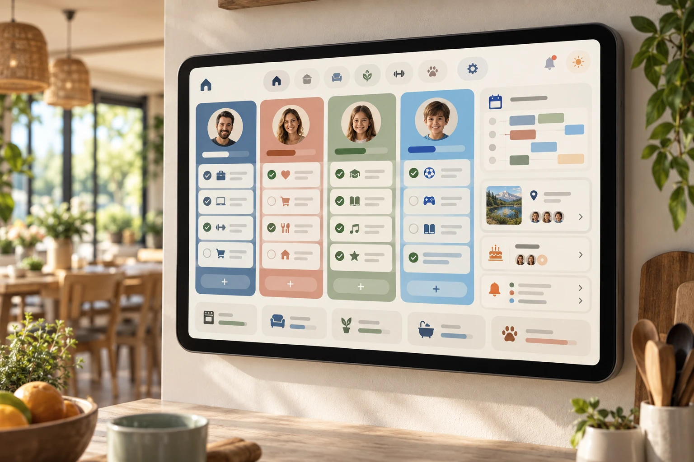
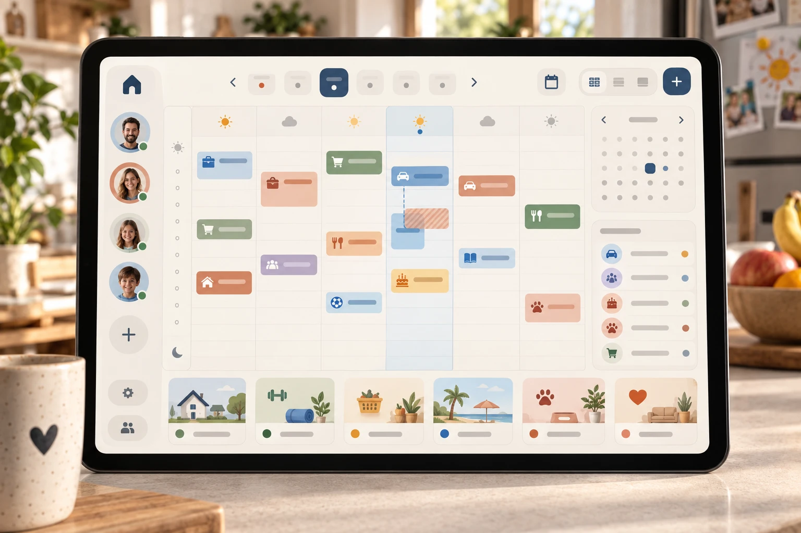
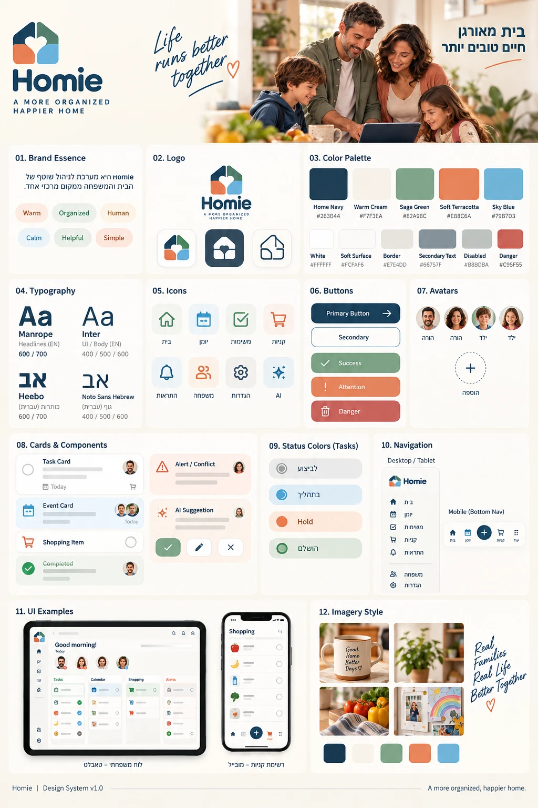
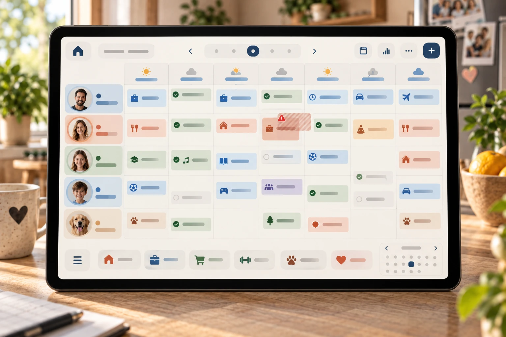

# DESIGN – Homie V1

מקורות: product-10-definitions.md, PRD.md, והתמונות wireframes.png, mockups.png ו-style-guide-v2.webp (השפה העיצובית מ-9.11.2026; style-guide.png הקודם כבר לא בתוקף).
שמות המסכים זהים לשמות ב-PRD.

**שם המוצר: Homie.** בתמונות (wireframes, mockups, style guide) מופיע השם הקודם "Home-me". בכל מקום שבו הוא מופיע בתמונה — לוגו, מסך הכניסה, הסרגל העליון ותג המקור של אירוע פנימי — כותבים "Homie". שאר העיצוב בתמונות בתוקף.

**שתי תמונות ההשראה (נוספו 8.11.2026)** קובעות רק את **מבנה** התצוגות: עמודה צבעונית לכל בן בית עם אווטאר בראשה (יומי), וטבלת ימים ושעות עם בלוקים צבעוניים ומקרא בני הבית בצד (שבועי). השפה העיצובית לפי style-guide-v2.webp (חלק 2). מה שמופיע בהן ולא נבנה: מזג אוויר, תמונות, אריחי קטגוריות בתחתית, פס התקדמות, הגדרות ולוח חודש קטן בצד.

---

## חלק 1 – Screens

### כלל: מה מוצג בכל שלב
התמונות מציגות את המוצר המלא, כולל פיצ'רים שנבנים רק אחרי ה-MVP. **רכיב ממשק מופיע רק מה-Milestone שבונה את הפיצ'ר שלו** (MILESTONES.md). עד אז הוא מוסתר לגמרי: לא מוצג במצב "לא זמין", ולא מוביל לדף ריק.

| רכיב בתמונות | פיצ'ר | מופיע החל מ- |
|---|---|---|
| חיווי "עודכן לאחרונה" (כפתור הרענון עצמו, F47, מופיע כבר מ-Milestone 3) | F11 | Milestone 7 |
| מראה מוחלש וקו חוצה למשימה שהושלמה | F08 | Milestone 7 (עד אז: הצ'יפ "הושלמה" וה-Checkbox המסומן בלבד) |
| עריכת אירוע פנימי (לחיצה על כרטיס אירוע) | F19 | Milestone 7 (עד אז כרטיס אירוע אינו לחיץ) |
| שינוי כמות, ✕ מחיקה, התראה על כפילות והודעת "בטל" בקניות | F25, F27, F26, F46 | Milestone 7 (עד אז הכמות מוצגת כטקסט, ואין ביטול לסימון) |
| צ'יפ "חפיפה" | F10 | Milestone 8 |
| שדה "תזכורת" בחלון המשימה | F17 | Milestone 8 |
| שדה "חזרתיות" בחלון המשימה | F16 | Milestone 8 |
| תפריט התצוגה (יומי / שבועי / חודשי), התצוגה היומית בעמודות, היומן השבועי והחודשי | F51, F52, F21, F53 | Milestone 10 (עד אז: הכותרת "לוח היום" וה-Timeline). היומן השבועי **אינו** לשונית בסרגל הניווט; בסרגל שלוש לשוניות: לוח, קניות, ממתין לאישור |

### כניסה
**המטרה:** כניסה של הורה למערכת (F01). המסך לא נמנה בארבעת המסכים המרכזיים של ה-PRD, אבל הוא נדרש לטופס הכניסה.

**מה יש במסך:**
- שם המוצר Homie, השאלה "מה מתכננים להיום?", ומתחתיה השורה "פחות דיבורים ויותר זמן ביחד" (שונה 8.11.2026; ב-mockups.png מופיע הנוסח הקודם).
- כרטיס כניסה: כותרת "כניסה", שורת הסבר "כניסה להורים בלבד", שדה אימייל, שדה סיסמה.
- כפתור ראשי "כניסה" לרוחב הכרטיס.

**מה קורה בו:** הורה מזין אימייל וסיסמה ולוחץ "כניסה". אחרי כניסה מוצלחת עוברים ל**לוח היום**. אין הרשמה ואין שחזור סיסמה.

---

### לוח היום (Home)
**המטרה:** לענות במבט אחד על "מי אחראי למה היום?".

**מה יש במסך (טלפון):**
- סרגל עליון: "לוח היום" ושם המוצר.
- שורת תאריך ("יום ב׳, 12.10") וליד החיווי "עודכן לאחרונה: 14:32" עם אייקון רענון.
- **מעבר בין ימים (F42, לא מופיע בתמונות):** משני צידי התאריך חצים ‹ › (כפתורי אייקון 44×44, עם `aria-label` "היום הקודם" / "היום הבא"). בכיוון RTL, החץ הימני הוא היום הקודם והשמאלי הוא הבא, כמו בחצי השבוע ביומן השבועי. כשמוצג יום שאינו היום, מופיע ליד התאריך כפתור משני קטן "היום". כותרת הקטע "משימות ללא שעה" ו-"היום לפי שעות" נשארות, והתאריך בשורה מראה איזה יום מוצג.
- **משימות ללא שעה:** כרטיסי משימה בלי שעה.
- **היום לפי שעות (Timeline):** שורות לפי שעה. בכל שורה כרטיסי משימות ואירועים.
- **כרטיס משימה:** Checkbox, שם המשימה, שעה, אווטאר ושם של האחראים, וצ'יפ סטטוס ("לביצוע" / "הושלמה").
  - **ה-Checkbox הוא הפקד היחיד שמשנה סטטוס בכרטיס.** סימון = "הושלמה", ביטול סימון = "לביצוע". יש לו `aria-label` עם שם המשימה (למשל "סמן כהושלמה: להסיע את נועה לבית הספר").
  - **צ'יפ הסטטוס הוא תצוגה בלבד**, כדי שהסטטוס לא יועבר רק דרך הצבע וה-Checkbox. אינו לחיץ ואין בו חץ ▾. **החלטה זו גוברת על wireframes.png ו-mockups.png**, שבהם מופיע "לביצוע ▾".
- **כרטיס אירוע:** רקע בגוון של בן הבית ופס צבע בצד, שם האירוע, טווח שעות, אווטאר ושם, ותג מקור: "Homie" או "Google".
- **סימון חפיפה:** צ'יפ טרקוטה בהיר, אייקון משולש והמילה "חפיפה", על שני הפריטים החופפים של אותו בן בית.
- **משימה שהושלמה:** Checkbox מסומן, כותרת עם קו חוצה, צבע מוחלש וצ'יפ "הושלמה".
- כפתור + עגול בפינה. לחיצה פותחת תפריט קטן: "משימה חדשה" ו"אירוע חדש".
- סרגל ניווט תחתון: לוח היום, קניות, ממתין לאישור (עם מונה). מ-Milestone 10 הלשונית הראשונה נקראת "לוח", כי היא מציגה גם שבוע וחודש.

**מה יש במסך (מחשב וטאבלט):** אותו תוכן בפריסה רחבה.
- סרגל עליון: Homie, ארבעת הקישורים (הפעיל מסומן בכמוסה בנייבי בהיר, לפי חלק 2), מונה ב"ממתין לאישור", "עודכן לאחרונה" וכפתור "רענון".
- כותרת "לוח היום" עם התאריך, חצי מעבר בין ימים וכפתור "היום" (כמו בטלפון), וכפתור "הוספה ▾" עם אותו תפריט.
- משימות ללא שעה בשורה אחת של כרטיסים. פריטים חופפים באותה שעה מוצגים זה לצד זה.

**מה קורה בו:**
- לחיצה על ה-Checkbox משנה סטטוס בין "לביצוע" ל"הושלמה", והצ'יפ מתעדכן בהתאם.
- לחיצה על שאר הכרטיס (לא על ה-Checkbox) פותחת את **יצירה ועריכה של משימה**.
- "משימה חדשה" פותח את **יצירה ועריכה של משימה**, ו"אירוע חדש" פותח את **יצירה ועריכה של אירוע פנימי**.
- רענון (F47) טוען מחדש את נתוני היום המוצג בלי לטעון את הדף, ומעדכן את "עודכן לאחרונה" (F11, כשהוא קיים).
- חץ טוען את משימות ואירועי היום הקודם או הבא. "היום" חוזר להיום. "משימה חדשה" ו"אירוע חדש" מוזנים מראש בתאריך היום המוצג.

#### תפריט התצוגה (F51, Milestone 10)
- הכותרת "לוח היום" הופכת לכפתור עם ▾: "יומי ▾", "שבועי ▾" או "חודשי ▾" לפי התצוגה, עם `aria-haspopup` ו-`aria-expanded`. כותרת ה-`h1` עצמה נשארת (מוסתרת ויזואלית) כדי שלמסך יהיה שם.
- לחיצה פותחת רשימה קטנה בעיצוב תפריט ההוספה הקיים: "יומי", "שבועי", "חודשי". הבחירה הנוכחית מסומנת ב-✓ וב-`aria-checked`. Escape או לחיצה בחוץ סוגרים.
- שורת התאריך מתאימה את עצמה: יומי – "יום ב׳, 12.10"; שבועי – "11.10 – 17.10"; חודשי – "נובמבר 2026". ה-`aria-label` של החצים: "היום/השבוע/החודש הקודם" ו"הבא". "היום" חוזר לתקופה שמכילה את היום.
- הלוח נפתח תמיד ב"יומי" על היום. "משימה חדשה" ו"אירוע חדש" מוזנים בתאריך היום המוצג; בשבועי ובחודשי – בתאריך היום אם הוא בתקופה המוצגת, אחרת ביום הראשון שלה.

#### התצוגה היומית (F52, Milestone 10)
- עמודה לכל בן בית, לפי הסדר ב-`members.json`. העמודה כולה על רקע בגוון של בן הבית, ובראשה אווטאר עגול ושם (המראה לפי "עמודת בן בית" בחלק 2), והכרטיסים בתוכה כמו בלוח.
- בתוך העמודה, מלמעלה למטה: משימות ואירועים בלי שעה, ואחריהם פריטים עם שעה לפי שעת התחלה. אותם כרטיסי משימה ואירוע כמו היום (Checkbox, שעה, צ'יפים, תג מקור). כרטיס בתוך עמודה לא מציג שוב את האווטאר של בעל העמודה, אלא רק את שאר המשויכים ("גם: דנה").
- פריט עם כמה משויכים מופיע בכל אחת מהעמודות שלהם. סימון ה-Checkbox בעמודה אחת מתעדכן בכולן.
- עמודה "ללא שיוך" (לבן, בלי אווטאר) מופיעה בסוף רק כשיש פריטים בלי שיוך.
- עמודה ריקה מציגה "אין משימות היום" באפור. אם כל העמודות ריקות – מצב הריק הקיים.
- **טלפון (שונה 9.11.2026, Milestone 12):** בני הבית אחד מתחת לשני, ברוחב מלא, וגוללים למטה. לכל אחד ראש מקוצר בשורה אחת: אווטאר 32 ושם על רקע הגוון המלא שלו, ומימין מספר הפריטים. מתחתיו הכרטיסים על רקע הגוון הבהיר. **מחשב וטאבלט:** כל העמודות זו לצד זו ברוחב שווה, עם הראש הגבוה (חלק 2).
- סימון "חפיפה" נשאר על שני הפריטים החופפים של אותו בן בית, בתוך העמודה שלו.

---

### יצירה ועריכה של משימה (Modal)
**המטרה:** ליצור או לערוך משימה בלי לעזוב את הלוח.

**מה יש במסך:** חלון מעל הלוח המוכהה. כותרת ("משימה חדשה") וכפתור סגירה ✕. שדות:
- שם המשימה.
- תאריך, ושעה (לא חובה).
- אחראים: בחירה מרובה של בני הבית, עם Checkbox, אווטאר ושם.
- סטטוס (רשימה נפתחת).
- תזכורת (רשימה נפתחת).
- חזרתיות: ללא, יומי, שבועי.
- הערות.
- כפתורים: "שמור" (ראשי) ו"ביטול" (משני).
- **בעריכה בלבד (F44, לא מופיע בתמונות):** כפתור טקסט "מחיקה" עם אייקון פח, בצבע אדום לבנים, בצד השני של שורת הכפתורים, רחוק מ"שמור".

**מה קורה בו:** "שמור" שומר וסוגר, והמשימה מופיעה בלוח. "ביטול" או ✕ סוגרים בלי לשמור. "מחיקה" שואל "למחוק את המשימה?" עם "מחיקה" ו"ביטול". אישור מוחק, סוגר את החלון, והמשימה יוצאת מהלוח.

---

### יצירה ועריכה של אירוע פנימי (Modal)
**המטרה:** ליצור או לערוך אירוע של Homie.

**מה יש במסך:** חלון באותו מבנה. כותרת ("אירוע חדש") ו-✕. שדות: שם האירוע, תאריך, שעת התחלה, שעת סיום, משויכים (בחירה מרובה), הערות. כפתורים "שמור" ו"ביטול".

**מה קורה בו:** "שמור" שומר וסוגר, והאירוע מופיע בלוח ובתג "Homie".

**בעריכה בלבד (F19 ו-F45, לא מופיע בתמונות):** אותו כפתור "מחיקה" ואותו אישור כמו בחלון המשימה ("למחוק את האירוע?"). אירוע Google לא נפתח בחלון הזה ואין לו מחיקה.

---

### ממתין לאישור (Pending)
**המטרה:** מקום אחד לפריטים שממתינים להורה.

**מה יש במסך:**
- כותרת "ממתין לאישור" עם מונה, ושורת הסבר "פריטים שממתינים לפעולת הורה".
- **אירועי Google חדשים:** כרטיס לכל אירוע: שם, יום, תאריך ושעה, תג "Google", כפתור ראשי "בדוק ואשר", וכפתור משני "התעלם" (F43, לא מופיע בתמונות). הסידור כמו בכרטיס הצעת AI: ראשי ואחריו משני.
- **הצעות AI:** כרטיס עם אייקון ניצוצות, שם ההצעה ("להכין בגדי ספורט ובקבוק מים"), שורת "הצעה לאירוע: אימון כדורגל", וכפתורים "אשר" ו"דחה".
- סרגל ניווט תחתון.

**מה קורה בו:**
- "בדוק ואשר" פותח את **אישור ושיוך של אירוע Google**.
- "התעלם" מוציא את האירוע מהתיבה מיד, בלי חלון אישור, והמונה יורד. האירוע לא מופיע בלוח.
- "אשר" הופך את ההצעה למשימה רגילה בלוח. "דחה" מסיר אותה מהתיבה. המונה יורד בהתאם.

---

### אישור ושיוך של אירוע Google (Modal)
**המטרה:** לשייך אירוע מ-Google לבני הבית ולאשר אותו לפני שהוא נכנס ללוח.

**מה יש במסך:** חלון עם כותרת ו-✕. תג "Google · קריאה בלבד" עם אייקון מנעול. שדות נעולים בגוון גבול: שם האירוע, תאריך, שעת התחלה, שעת סיום. "שיוך לבן בית אחד או יותר" (בחירה מרובה). כפתורים "אשר ושייך" ו"ביטול".

**מה קורה בו:** "אשר ושייך" מאשר, סוגר וחוזר ל**ממתין לאישור**. האירוע מופיע ב**לוח היום** וב**יומן השבועי**.

---

### רשימת קניות (Shopping List)
**המטרה:** רשימת קניות משותפת ופשוטה.

**מה יש במסך:**
- כותרת "רשימת קניות".
- Quick Add: שדה "שם מוצר", שדה "כמות" וכפתור "הוספה".
- שורה לכל מוצר: Checkbox, שם המוצר, תיבת כמות, וכפתור מחיקה ✕.
- סרגל ניווט תחתון.

**מה קורה בו:** "הוספה" מוסיף מוצר לרשימה. סימון ה-Checkbox מעלים את המוצר מהרשימה, ובתחתית המסך, מעל סרגל הניווט, מופיעה למשך 5 שניות הודעה "סומן כנקנה: חלב" עם כפתור טקסט "בטל" (F46, לא מופיע בתמונות). ההודעה בכרטיס נייבי כהה עם טקסט לבן, פינה 12 וצל רך, ומוכרזת לקורא מסך (`aria-live="polite"`). "בטל" מחזיר את המוצר לרשימה. שינוי בתיבת הכמות מעדכן אותה. ✕ מוחק מיד, בלי חלון אישור.

---

### יומן שבועי (Calendar)
**המטרה:** תצוגה של השבוע כולו. מ-Milestone 10 זו תצוגה של לוח היום (תפריט התצוגה, "שבועי"), ולא מסך או לשונית נפרדים.

**מה יש במסך:**
- כפתור התצוגה "שבועי ▾" במקום הכותרת.
- טווח השבוע ("11.10 – 17.10") עם חצים לשבוע הקודם והבא. השבוע מתחיל ביום א׳.
- טבלה: עמודה לכל יום (א׳ עד ש׳, עם תאריך, והיום הנוכחי מודגש בעיגול נייבי הבית) ושורות שעות.
- בלוקים של משימות ואירועים בגוון של בן הבית, עם פס צבע ושם הפריט.
- מקרא בני הבית: אווטאר ושם.
- סרגל ניווט תחתון.

**הערה למימוש:** בתמונה, מי אחראי לבלוק מזוהה רק לפי צבע. כדי לעמוד בכלל "מצב לא מועבר בצבע בלבד", צריך להוסיף לבלוק אווטאר קטן או שם.

**פרטים (Milestone 10, לפי view-weekly.webp):**
- מעל שורות השעות שורה "ללא שעה" לכל יום, עם משימות ואירועי יום שלם.
- בלוק עם שעה ממוקם לפי שעת ההתחלה, וגובהו לפי משך הפריט (משימה בלי שעת סיום – שורה אחת). פריטים חופפים באותו יום מוצגים זה לצד זה.
- משימה שהושלמה – מוחלשת עם קו חוצה, כמו בלוח.
- לחיצה על בלוק פותחת את אותו חלון עריכה כמו בלוח (משימה, או אירוע פנימי); לחיצה על כותרת יום פותחת אותו בתצוגה היומית.
- מקרא בני הבית: בצד בשורה אנכית במחשב, ובשורה מעל הטבלה בטלפון.
- **טלפון (שונה 9.11.2026, Milestone 12):** במקום הטבלה, רשימה לפי ימים: כותרת לכל יום ("יום א׳, 8.11", היום מסומן בעיגול נייבי ובמילה "היום"), ומתחתיה כרטיסים ברוחב מלא – קודם הפריטים בלי שעה, אחר כך לפי שעה. אותם כרטיסי משימה ואירוע כמו ביומי, עם אווטארים של כל המשויכים. יום ריק מציג "אין פריטים" באפור. לחיצה על כותרת יום פותחת אותו ביומי. **בטלפון אין גרירה** (F54 עובד בטבלה, במחשב ובטאבלט); מזיזים פריט דרך חלון העריכה. **מחשב וטאבלט:** הטבלה, כל 7 הימים במסך.

---

### יומן חודשי (F53, Milestone 10)
**המטרה:** לראות במבט אחד באילו ימים בחודש יש למי משהו.

**מה יש במסך:**
- כפתור התצוגה "חודשי ▾", ושם החודש ("נובמבר 2026") עם חצים לחודש הקודם והבא.
- שורת ימי השבוע (א׳–ש׳) וטבלה של 5–6 שבועות. ימים מהחודש הקודם או הבא מוחלשים.
- בכל יום: המספר, ומתחתיו נקודה עגולה (8 פיקסלים) בצבע הפס של כל בן בית שיש לו באותו יום לפחות פריט אחד, לפי הסדר ב-`members.json`. נקודה בצבע מסגרת שדה לפריט בלי שיוך. היום הנוכחי מודגש בעיגול נייבי הבית, כמו ביומן השבועי.
- מקרא בני הבית מתחת לטבלה: נקודה ושם.

**מה קורה בו:** כל יום הוא כפתור, עם `aria-label` מלא, למשל "יום ג׳, 12.11: יואב, נועה" או "יום ג׳, 12.11: אין פריטים" – כך שהמידע לא מועבר בצבע בלבד. לחיצה פותחת את היום בתצוגה היומית.

---

### טלפון (Milestone 12, נוסף 9.11.2026)
נבדק על iPhone 17 (רוחב 402).
- **אזור עליון מקוצר בלוח:** שתי שורות בלבד מתחת לסרגל העליון: (1) כפתור התצוגה ("יומי ▾") ומשמאלו כפתור רענון; (2) חצים, התאריך וכפתור "היום" כשצריך. "עודכן לאחרונה" עובר לשורה קטנה מתחת לתאריך. בסרגל העליון לא חוזרים על שם המסך אם הוא כבר בכפתור התצוגה: בלוח מוצג רק הלוגו Homie והאווטאר.
- **מראה של אפליקציה כששומרים למסך הבית:** נפתח במסך מלא בלי סרגלי Safari (`apple-mobile-web-app-capable`, שם קצר "Homie", אייקון `apple-touch-icon` הקיים). צבע סרגל המערכת לפי `theme-color` (לבן בסרגל העליון). הסרגל העליון יורד מתחת ל-Dynamic Island, והסרגל התחתון וכפתור + נשארים מעל פס הבית (`env(safe-area-inset-*)`, `viewport-fit=cover`).
- **כפתורי החלון בטלפון:** שורת הכפתורים לא חורגת מהחלון. כשאין מקום, "מחיקה" עובר לשורה משלו מתחת ל"שמירה" ו"ביטול".

### ניווט בין המסכים
- **כניסה** ← **לוח היום**.
- המסכים המרכזיים (לוח היום, רשימת קניות, ממתין לאישור) נגישים תמיד: בסרגל התחתון בטלפון, ובסרגל העליון במחשב ובטאבלט. היומן השבועי והחודשי נפתחים מתפריט התצוגה בלוח (Milestone 10), ולא מהסרגל.
- **לוח היום** ← כפתור + ← יצירה ועריכה של משימה, או יצירה ועריכה של אירוע פנימי. לחיצה על משימה ← יצירה ועריכה של משימה.
- **ממתין לאישור** ← "בדוק ואשר" ← אישור ושיוך של אירוע Google ← חזרה לממתין לאישור.
- כל Modal נסגר וחוזר למסך שממנו נפתח.

### מה לא מופיע בתמונות
חצי המעבר בין ימים בלוח היום וכפתור "היום" (F42), כפתור "התעלם" בכרטיס אירוע Google (F43), כפתור "מחיקה" ואישור המחיקה בחלונות העריכה (F44, F45), מצבי ריק, טעינה ושגיאה, מצב Focus במסכים, מצב עריכה של החלונות, התג "עודכן ב-Google", התראה על מוצר כפול ויצירת משימה בלחיצה על שעה. הם מתוארים ב-PRD, אבל אין להם עיצוב בתמונות. העיצוב של המצבים נקבע בטבלה שלמטה.

### מצבים שלא מופיעים בתמונות (אושר 8.11.2026)
כל המצבים משתמשים רק בצבעים וברכיבים הקיימים.

| מצב | עיצוב |
|---|---|
| ריק · לוח היום | כרטיס עם מסגרת מקווקווה, אריח אייקון במרווה בהירה, "אין משימות להיום", וכפתור ראשי "הוספת משימה" |
| ריק · ממתין לאישור / קניות | כרטיס מקווקו קומפקטי עם אייקון ושורת הסבר אחת ("אין פריטים שממתינים", "הרשימה ריקה") |
| טעינה | שורות שלד (Skeleton) בצבע חול, בלי ספינר. "עודכן לאחרונה" מתחלף ל"מעדכן…" |
| שגיאה · הטעינה נכשלה | פס טרקוטה בהיר בראש התוכן: "לא הצלחנו לעדכן", זמן העדכון האחרון (אם יש), וכפתור "נסו שוב" |
| עודכן ב-Google (F32, Milestone 8) | צ'יפ שמיים בהירים, אייקון רענון והמילים "עודכן ב-Google". מוצג 3 ימים מהעדכון (F50, Milestone 9) |
| מוצר כפול בקניות (F26) | מסגרת טרקוטה לשדה "שם מוצר", והודעה באפרסק מתחתיו: "המוצר כבר ברשימה" עם "עדכון כמות" (ראשי) ו"ביטול" (משני) |
| מצב עריכה בחלון | אותו חלון, עם הכותרת "עריכת משימה" / "עריכת אירוע", השדות מלאים, וכפתור "שמירת שינויים" |
| Focus במקלדת | טבעת ה-Focus (חלק 2, "כפתורים ורכיבים") על כל רכיב לחיץ |

יצירת משימה בלחיצה על שעה (F13) היא Could ולא נבנית, ולכן אין לה עיצוב.

---

## חלק 2 – Style Guide

**הקוד:** כל הערכים בחלק הזה (צבעים, גופנים, מרווחים, פינות, צללים, גדלים) קיימים כמשתני CSS ב-[`tokens/tokens.css`](../tokens/tokens.css) (ובפורמט JSON ב-`tokens/tokens.json`). הקוד משתמש במשתנים ולא בערכים קבועים. אם יש הבדל בין הקובץ למסמך, המסמך קובע ומעדכנים את הקובץ.

**השפה העיצובית החדשה (אושרה 9.11.2026, Milestone 11).** style-guide-v2.webp קובע צבעים, גופנים וסגנון רכיבים. view-daily.webp, view-weekly.webp ושלוש תמונות ה-mockup-v2 מראות את המראה הסופי. **רק המראה משתנה, המבנה נשאר:** סרגל הניווט העליון, העמודות ביומי, טבלת השבוע והחלונות נשארים כמו היום. מה שמופיע בתמונות ולא נבנה: תפריט צד, יומן שבועי בשורה לכל בן בית, תמונות של בני הבית (נשארים עיגולים עם אות), חיית מחמד, אייקון לפי נושא, מזג אוויר, צירוף קבצים ותמונות, בוחר צבע או צורה, אריחי קטגוריות ולוח חודש קטן בצד. הטקסט באנגלית בתמונות (Primary Button, Task Card...) הוא דוגמה; הממשק בעברית לפי PRD.

### האווירה
חמה, מסודרת ואנושית: בית מאורגן, חיים טובים יותר. רקע קרם חם, משטחים לבנים ונקיים, פינות מעוגלות, וכחול-נייבי אחד להדגשה. כל בן בית מזוהה בצבע רך משלו. עומק נוצר מגוון ומצל עדין, לא מקו כבד.

### צבעים (60-30-10)

**60% – ניטרליים וטקסט**
| שם | HEX | שימוש |
|---|---|---|
| קרם חם | `#F7F3EA` | רקע המסך |
| לבן | `#FFFFFF` | כרטיסים, חלונות, סרגלים |
| משטח רך | `#FCFAF6` | שדות, כפתור ביטול, אריחים נייטרליים, רקע משנה בתוך חלון |
| גבול | `#E7E4DD` | קווים, מפרידים, מסגרת כרטיס |
| נייבי כהה | `#213440` | כותרות וטקסט ראשי |
| טקסט משני | `#5E6B74` | טקסט משני, מטא ואייקונים. כהה מעט מ-`#66757F` שבתמונה, כדי לעמוד בניגודיות 4.5:1 על הקרם |
| מסגרת שדה | `#868F95` | מסגרת שדה ו-Checkbox ריק (3:1 על לבן ועל משטח רך) |
| מושבת | `#B8BDBA` | כפתור ורכיב לא זמינים (לא לטקסט חשוב) |
| קו מקווקו | `#DCD7CC` | קווי שעות ומסגרת מצב ריק |

**30% – צבעי הבית (גוון מלא + גוון בהיר)**
| שם | מלא | בהיר | שימוש |
|---|---|---|---|
| כחול פלדה | `#5E80A3` | `#E5ECF3` | בן בית (יואב) |
| טרקוטה רכה | `#E88C6A` | `#FBE7DE` | בן בית (דנה), אזהרה |
| ירוק מרווה | `#82A98C` | `#E6EFE8` | בן בית (נועה), "הושלמה" |
| כחול שמיים | `#79B7D3` | `#E4F1F8` | בן בית (איתי), אירוע, עודכן ב-Google |
| אפרסק | – | `#FDEBDD` | ממתין לאישור, הודעה |
| נייבי בהיר | – | `#E3EAF0` | לשונית פעילה, הצעת AI, אריח אייקון של משימה |

**10% – הדגשה ומצב**
| שם | HEX | שימוש |
|---|---|---|
| נייבי הבית | `#1E3F56` | כפתור ראשי, כפתור +, לשונית פעילה, קישור, Focus. (בתמונה כתוב `#263B44`, אבל הצבע שמוצג בה הוא הנייבי הזה, ולכן נבחר הוא) |
| נייבי לחוץ | `#16303F` | כפתור ראשי לחוץ |
| הצלחה | `#4F7D5C` | Checkbox מסומן, כפתור הצלחה (לבן עליו 4.75:1) |
| הצלחה – טקסט | `#3D6B4B` | טקסט על ירוק מרווה בהיר |
| אזהרה – מילוי | `#B8582F` | כפתור "שימו לב" (טרקוטה כהה, כדי שטקסט לבן יהיה קריא) |
| אזהרה – טקסט | `#8A4A2C` | טקסט על אפרסק |
| סכנה | `#C95F55` | אייקון התראה, מונה, מסגרת שדה שגוי |
| סכנה – מילוי | `#B5483E` | כפתור מחיקה |
| סכנה – טקסט | `#A8443A` | טקסט "חפיפה" ושגיאות |

הגוונים המלאים של בני הבית (כחול פלדה, טרקוטה, מרווה, שמיים) משמשים לרקעים, פסים וטבעות בלבד, ולא לטקסט או למילוי שעליו טקסט לבן, כי הניגודיות שלהם נמוכה.

**צבע לכל בן בית במסכים:** יואב – כחול פלדה, דנה – טרקוטה רכה, נועה – ירוק מרווה, איתי – כחול שמיים. הערכים נשמרים ב-`members.json` (`tint` = הגוון הבהיר, `color` = הגוון המלא).

**כללי צבע לפי מספר המשויכים** (חל על כרטיס אירוע, כרטיס משימה ובלוק ביומן השבועי):
| מצב | רקע ופס צבע | מה מוצג חוץ מהצבע |
|---|---|---|
| בן בית אחד | הגוון הבהיר שלו, ופס בגוון המלא | אווטאר ושם |
| כמה בני בית | של **הראשון מביניהם לפי הסדר ב-`members.json`** (לא לפי סדר הבחירה), כדי שהצבע יהיה יציב | אווטאר ושם של כולם |
| אף אחד (למשל הצעת AI שאושרה ועוד לא שויכה) | לבן ופס במסגרת שדה `#868F95` | הטקסט "ללא שיוך" בטקסט משני, בלי אווטאר |

כרטיס משימה רגיל לבן, כמו בתמונות. Checkbox מסומן תמיד בירוק הצלחה (לא בצבע בן הבית). הסדר ב-`members.json` הוא גם סדר בני הבית בבוחר המשויכים ובמקרא היומן השבועי.

**שכבת הכהיה מאחורי חלון:** נייבי הבית `#1E3F56` בשקיפות 40%.

**ניגודיות:** כל זוגות הטקסט על רקע עומדים ב-4.5:1 לפחות.

### גופנים
שני גופנים לעברית, שניהם תומכים גם בלטינית:
- **Heebo** – כותרות. משקלים SemiBold 600, Bold 700.
- **Noto Sans Hebrew** – גוף טקסט, כפתורים, שדות וצ'יפים. משקלים Regular 400, Medium 500, SemiBold 600.

Manrope ו-Inter שבתמונה מיועדים לממשק באנגלית ולא נטענים; שם המוצר מוצג כקובץ לוגו.

| שימוש | גופן | גודל / גובה שורה | משקל |
|---|---|---|---|
| שם המוצר (כטקסט) | Heebo | 32 / 40 | Bold 700 |
| כותרת מסך | Heebo | 24 / 32 | Bold 700 |
| כותרת קטע | Heebo | 20 / 28 | SemiBold 600 |
| כותרת כרטיס | Noto Sans Hebrew | 16 / 24 | SemiBold 600 |
| גוף טקסט | Noto Sans Hebrew | 16 / 26 | Regular 400 |
| מטא וכיתוב | Noto Sans Hebrew | 14 / 20 | Regular 400 |
| כפתור ותווית שדה | Noto Sans Hebrew | 16 / 24 | SemiBold 600 |
| תגיות ומונים (צ'יפים, תגי מקור, מונה) | Noto Sans Hebrew | 12 / 16 | SemiBold 600 |

הכיוון מימין לשמאל. שעות, תאריכים ומספרים מוצגים משמאל לימין בתוך השורה. גודל טקסט מינימלי 14; תגיות ומונים בלבד ב-12 (חריג שאושר 8.11.2026).

### כפתורים ורכיבים
- **כפתור ראשי:** רקע נייבי הבית, טקסט לבן, גובה 48, פינה 12. אפשר אייקון (וי בחלון, חץ בפעולה). לחוץ: נייבי לחוץ.
- **כפתור משני:** רקע לבן, מסגרת נייבי הבית 1.5, טקסט נייבי הבית.
- **כפתור ביטול בחלון:** רקע משטח רך, טקסט נייבי כהה, בלי מסגרת.
- **כפתור הצלחה / שימו לב / מחיקה:** מילוי הצלחה, אזהרה – מילוי או סכנה – מילוי, טקסט לבן ואייקון.
- **כפתור לא זמין:** רקע גבול, טקסט טקסט משני.
- **כפתור +:** עיגול 56 בנייבי הבית עם + לבן, וצל רך. פותח את התפריט "משימה חדשה" / "אירוע חדש".
- **כפתור אייקון:** ריבוע מעוגל 44×44 (פינה 12) ברקע משטח רך, אייקון בטקסט משני, ו-`aria-label` חובה. כך גם ✕ בחלון.
- **Focus במקלדת:** טבעת נייבי הבית בעובי 2, במרחק 2 מהרכיב (`--focus-ring`).
- **שדה:** רקע משטח רך, מסגרת גבול 1, פינה 12, גובה 52, תווית מעל השדה. אייקון בצד ההתחלה (יומן לתאריך, שעון לשעה) וחץ ▾ ברשימה נפתחת. Focus: מסגרת נייבי הבית 2 והילה בנייבי בהיר. **שגיאה:** מסגרת סכנה 2, ומתחת טקסט בסכנה – טקסט עם אייקון משולש.
- **בוחר בני בית (בחירה מרובה), לפי mockup-v2:** שורת אווטארים עגולים בגודל 56 עם השם מתחת. נבחר: טבעת נייבי הבית 2.5 ותג וי קטן בפינה. מבחינת נגישות כל אחד הוא Checkbox עם השם.
- **Radio (חזרתיות):** עיגול 20, נייבי הבית כשנבחר.
- **Checkbox:** **עיגול** 24 (כמו בכרטיס המשימה בתמונה). ריק: מסגרת מסגרת שדה 2. מסומן: מילוי ירוק הצלחה עם וי לבן.
- **כרטיס:** לבן, מסגרת גבול 1, פינה 16, צל זעיר, ריווח פנימי 16.
- **כרטיס משימה:** לבן. Checkbox עגול בצד ההתחלה, כותרת, ושורת מטא (שעה, צ'יפ, אווטארים). הושלמה: רקע ירוק מרווה בהיר, Checkbox מסומן, כותרת בקו חוצה ובטקסט משני.
- **כרטיס אירוע:** רקע הגוון הבהיר של בן הבית ופס 4 בגוון המלא בצד ההתחלה (לפי כללי הצבע), ואריח אייקון יומן.
- **אריח אייקון (אייקון לפי סוג):** ריבוע מעוגל 36 (פינה 12) ברקע בהיר עם אייקון בצבע כהה. משימה: אייקון וי בתיבה על נייבי בהיר. אירוע Homie: אייקון יומן על כחול שמיים בהיר. אירוע Google: אייקון יומן על כחול שמיים בהיר, עם תג "Google". אין אייקון לפי נושא.
- **חלון (Modal), לפי mockup-v2:** כרטיס לבן, פינה 24, צל חלון, ושכבת ההכהיה מאחוריו. בראש: אריח אייקון עגול 56 בנייבי בהיר, כותרת ו-✕ בכפתור אייקון. שדות בשתי עמודות כשיש מקום (תאריך ושעה זה לצד זה), שדה הערות רחב, ובתחתית ביטול וכפתור ראשי עם וי.
  - **בטלפון:** חלון מרכזי ברוחב המסך פחות 16 מכל צד, צמוד לחלק העליון (לא Bottom Sheet). כשהתוכן ארוך, גוף החלון נגלל, והכותרת ושורת הכפתורים נשארות במקום. שדות בעמודה אחת.
  - **במחשב ובטאבלט:** רוחב 560 לכל היותר, במרכז המסך.
  - **התנהגות:** בפתיחה ה-Focus עובר לשדה הראשון, ו-Tab נשאר בתוך החלון. Esc, ✕ ו"ביטול" סוגרים בלי לשמור, וה-Focus חוזר לכפתור שפתח את החלון. לחיצה על שכבת ההכהיה לא סוגרת.
- **כרטיס התראה (חפיפה / קונפליקט):** רקע טרקוטה בהיר, אייקון משולש בסכנה, כותרת בסכנה – טקסט.
- **כרטיס הצעת AI:** רקע לבן, אייקון ניצוצות בנייבי, ושורת כפתורים: אישור (הצלחה, אייקון וי), עריכה (משני, עיפרון), דחייה (משני, ✕).
- **צ'יפים:** כמוסה (פינה מלאה), גובה 24, אייקון קטן לפני הטקסט. תצוגה בלבד, לא לחיצים. לביצוע: משטח רך עם מסגרת גבול, טקסט נייבי כהה, עיגול ריק. הושלמה: ירוק מרווה בהיר, הצלחה – טקסט, וי. ממתין לאישור: אפרסק, אזהרה – טקסט, שעון. חפיפה: טרקוטה בהיר, סכנה – טקסט, משולש. עודכן ב-Google: כחול שמיים בהיר, נייבי הבית, רענון. הצעת AI: נייבי בהיר, נייבי הבית, ניצוצות.
- **בלוק ביומן השבועי:** רקע הגוון הבהיר של בן הבית, פס 4 בגוון המלא, פינה 8, ואייקון סוג קטן לפני הכותרת.
- **עמודת בן בית (תצוגה יומית), לפי view-daily.webp:** פינה 20, רקע הגוון הבהיר של בן הבית, ראש העמודה בגוון המלא עם אווטאר 48 בעיגול לבן והשם בטקסט נייבי כהה על פס לבן מתחת לאווטאר. הכרטיסים בתוכה לבנים.
- **תגי מקור:** "Homie" ו-"Google" ככמוסה לבנה עם מסגרת גבול ואייקון קטן.
- **סרגל ניווט עליון:** לבן, צל זעיר. לוגו בצד ההתחלה. לשונית פעילה: טקסט נייבי הבית על כמוסה בנייבי בהיר. מונה: עיגול בסכנה – מילוי עם מספר לבן (הגוון "סכנה" עצמו חלש מדי לטקסט לבן בגודל 12).
- **סרגל ניווט תחתון (טלפון):** לבן, פינות עליונות 24, צל רך. לשונית פעילה בנייבי הבית עם כמוסה בנייבי בהיר סביב האייקון.
- **אייקונים:** קו (Outline) בעובי 1.75, פינות מעוגלות. בצבע טקסט משני, או כהה על אריח בהיר.
- **אווטארים:** עיגול בגוון הבהיר של בן הבית, טבעת 2 בגוון המלא, והאות הראשונה בנייבי כהה, SemiBold. גדלים: 24, 32, 48, 56, 72. אין תמונות של בני הבית.
- **שמות בני הבית:** יואב, דנה, נועה, איתי.

### פינות וצורות
- כמוסה (מלא): צ'יפים, תגי מקור, לשונית פעילה.
- 8: בלוקים ביומן השבועי.
- 12: כפתורים, שדות, כפתורי אייקון ואריחי אייקון.
- 16: כרטיסים ותפריטים נפתחים.
- 20: עמודות בתצוגה היומית ומכלים גדולים.
- 24: חלונות וסרגל ניווט תחתון.
- עיגול: אווטארים, Checkbox, Radio וכפתור +.

### מרווחים
רשת 8: 4, 8, 16, 24, 32, 48.
- ריווח פנימי בכרטיס: 16.
- בין כרטיסים: 12.
- בין קטעים: 32–48.
- שוליים במסך: 20 (טלפון), 32 (מחשב).

### צללים
צללים בגוון נייבי, עדינים:
- **צל זעיר:** `0 1px 3px`, נייבי בשקיפות 6%. לכרטיסים ולסרגל העליון.
- **צל רך:** `0 6px 20px`, נייבי בשקיפות 8%. לתפריטים נפתחים, לכפתור + ולסרגל התחתון.
- **צל חלון:** `0 16px 48px`, נייבי בשקיפות 16%. לחלון.
